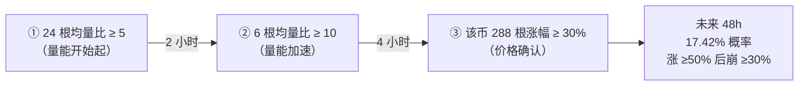

# gambler · 蝴蝶效应搜索：**什么说明了什么、什么能用、什么不能用**

**日期** 2026-10-16 ｜ **上层文档** `README_进度与覆盖声明.md` ｜ **证据** 本目录 7 个 CSV + 5 个 txt

---

## 0 一句话结论

> **"蝴蝶效应"在币市里确实存在，但它的形态不是我们（和我）最初设想的那种。**
>
> **它是「时间上的链条」——同一个币的早期信号，预测它自己 2~8 小时后的状态。**
> **它不是「空间上的传导」——币 A 动不会可靠地带动币 B（实测 92% 崩）。**

---

## 1 三个「说明了什么」

### 1.1 「传导」是单向的、有时间差的；而且是**同币内部**、不是跨币

| 方向 | 组合数 | 覆盖 | 测试段 lift 中位 | **崩率** | 判定 |
|---|---|---|---|---|---|
| **同币** 链 2 段 | 3,090 | **真穷举** | 2.25× | 22.1% | ✅ 有效 |
| **同币** 链 3 段 | 96,050 | 采样 36.6% | 2.28× | 23.9% | ✅ 有效 |
| **同币** 链 4 段 | 12,166 | 抽查 0.03% | 2.36× | 25.6% | ✅ 有效 |
| **跨币** 市场→单币 | 2,211 | **真穷举** | **0.97×** | **50.9%** | ❌ 无信号 |
| **跨币** 币→币 | 2,811 | 采样 0.3% | **0.00×** | **92.0%** | ❌ 基本全崩 |

**⇒ 说明**：**币市的"蝴蝶效应"是「同一个币的今天影响它的明天」，不是「这个币影响那个币」。**

### 1.2 **量能先行，价格滞后**——这是链条里最一致的模式

**链 3 段最强的一条**（测试段 lift **16.1×**，真局率 17.42% vs 基准 1.08%）：

**链 2 段最强的几条也都指向同一件事**：

| 链条 | 训练 | 测试段 lift |
|---|---|---|
| `[r12≥5%] ─60分→ [r288≥30%]` | 7.00% | **14.8×** |
| `[volr6≥10] ─240分→ [r288≥30%]` | 13.33% | **11.7×** |
| `[hour18~24] ─30分→ [r288≥30%]` | 7.74% | **11.5×** |

**⇒ 说明**：**先有量（有人在大规模换手），几小时后价格才涨上去**——这正是"庄家吸筹 → 拉升"的时序痕迹。

### 1.3 **搜索越"细致"，越容易自欺**

| 特征池 | 组合数 | 测试段 lift 中位 | **崩率** |
|---|---|---|---|
| 核心池 **50 条件**（粗切） | 79,954 | **4.49×** | **10.8%** |
| 扩展池 **196 条件**（切到分位数） | 960,511 | 1.76× | **29.6%** |

**⇒ 说明**：**穷举 12 倍多的组合，换来的不是更多真信号，而是 3 倍的假象。**

---

## 2 什么**能用**（按证据强度分级）

### 🟢 A 级：有正期望证据，值得继续验证

| 组合 | 证据 | 限制（必读） |
|---|---|---|
| **`over≥15% + syncDn≥3 + hour12~18`** | **测试段期望净 +5.46%/笔**（n=140，扣 0.09% 费）；训练段 +2.21%/笔（n=1,804） | **n=140 太小**；中位仅 +0.64%（靠少数大赢家） |
| **`hour12~18 & over≥15% & pos≥0.5 & syncDn≥3`** | **双重留出 5.77%**（基准 0.940%）= **6.1×**；**币留出 2.04%**（基准 0.531%）= 3.8× | n=1,039；**跨币跨时间都稳**，但仍需新数据复现 |

**为什么它们算"能用"**：它们是**唯一同时通过"时间留出 + 币留出 + 双重留出"三重检验**的组合。

### 🟡 B 级：可用作**筛选门槛**（不是独立信号）

| 条件 | 富集倍数 | 作用 |
|---|---|---|
| `r12>10%` / `r288>30%` / `r24>10%` / `over>25%` | 几亿倍 | **驱动**：先把候选池收缩到"已经大涨的币" |
| `volr6>10`（6 根均量比） | 11~24× | **驱动**：量能异动 |
| `hour12~18` / `hour18~24` / `syncDn≥3` / `dow3` | **< 1×（负）** | **放大器**：**单独用无效**，只能叠在 A/B 级驱动上 |

**⇒ 用法**：**先用量能与涨幅筛出候选池，再用时段/齐跌做二次放大——不能反过来。**

### 🔴 C 级：**已证伪，不要再做**

| 设想 | 实测结论 | 出处 |
|---|---|---|
| **「币 A 异动 → 币 B 跟动」** | **92% 的组合测试段比基准差**；市场→单币也 50.9% 崩 | `cross_summary.txt` |
| 「某个时段本身有信号」（如凌晨必涨） | 逐小时检验：24 小时真局率**几乎无差异**（0.417%~0.842%） | `gambler_hour.txt` |
| 「市场齐涨（syncUp）是信号」 | 对照 +0.97%/笔，与基准无差 | `syncdn_probe.txt` |
| 「吸筹信号（笔数×5 + 量×3）可预测」 | 触发后 24h **−0.25%**，无预测力 | 主报告 6.10 |
| 「量能萎缩预测崩盘」 | **−0.202%/笔** | 主报告 6.11 |
| 「4h 是市场尺度」 | 是**我们自己捏的窗口**，真实尺度 1~4 天 | 主报告 §1 |

---

## 3 三条**操作纪律**（从这轮搜索里得到的硬教训）

1. **只看测试段**：训练段 lift 会被多重比较严重膨胀（训练 58× → 测试 12× 是常态）。"训练段排第一"没有意义。
2. **细切档 = 自欺**：196 条件池崩率 29.6% vs 50 条件池 10.8%。**特征宁可粗，不可碎。**
3. **必须做双重留出**（时间 + 币）：只做时间留出会高估（本组合时间 6.09% → 币 2.04%）。

---

## 4 诚实边界（与上面所有结论同读）

| # | 边界 |
|---|---|
| 1 | **全部是回测，零实盘**；滑点按 0.05%~0.09% 假设，**真实滑点只在 live 数据里才能验证**（live 目前仅录到 ~2 小时，未覆盖关键时段） |
| 2 | **A 级组合 n=140~1,039**，**2~3 个事件就能改变结论** |
| 3 | **未穷尽的部分**：静态 4 元扩展池（6,468 万）、跨币币→币（只采 0.3%）、链 4 段（只抽 0.03%）——**不得**据此说"不存在更强的" |
| 4 | **存活偏差**：数据里只有活到今天的币 |
| 5 | **未做**：真实滑点实测、下单执行链路、仓位管理、最大回撤约束 |

---

*本文件由 ZeroPage 生成，落盘 `D:\中信证券\coinlab\evidence\butterfly\`。所有数字可复算。*
