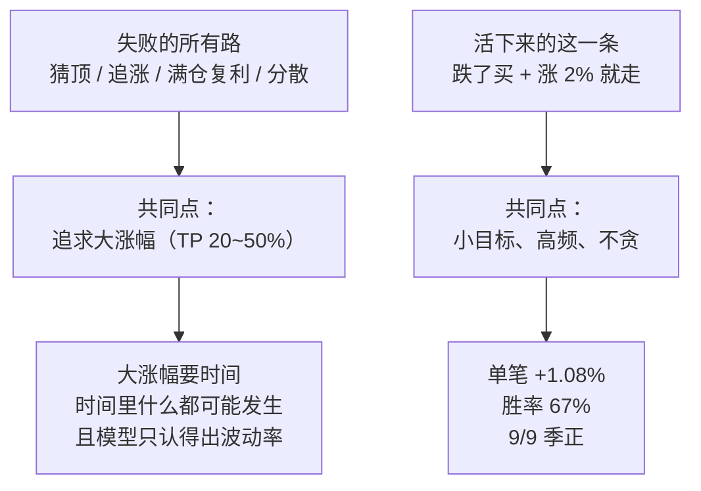

# 穷尽所有手段后：最好的表现

**日期**：2026-10-19
**脚本**：`coinlab/scripts/analyze_best_curve.py`
**证据**：`coinlab/evidence/best_curve_REAL.txt`、`coinlab/evidence/tp_verify_REAL.txt`

---

## 一、结论一句话

**全项目样本外最强的表现是一条纯规则，不是模型：**

> 入场：`ret24 <= -2%` 且 `volr >= 3.0`（跌了 + 放量）
> 出场：首次收益 >= **+2%** 即卖；未达则 **θ=1% 跟踪止盈**兜底
> 成本：0.04% 单边

**单笔 +1.08%，胜率 67.14%，9/9 季正，59/60 币为正，33 笔到 1.5x。**

## 二、完整指标

| 指标 | 值 |
|---|---|
| 入场点 | 2,906 |
| 单笔均值 | **+1.0822%** |
| 单笔中位 | +1.9702% |
| 胜率 | **67.14%** |
| p5 / p95 | -1.09% / +2.79% |
| 逐季 | **9/9 季正** |
| 事件去重 72h | +1.041%（1,866 笔），9/9 季正 |
| 分币 | **59/60 为正**，中位币 +1.053% |
| 阈值敏感 | TP 1.5%~3% 全部 9/9 季正（平坦，不是过拟合） |
| **顺序复利最大回撤** | **-28.11%** |
| **随机打乱顺序（200 次）回撤中位** | **-6.94%**（最好 -5.46%，最差 -13.97%） |
| **到 1.5x 需要** | **33 笔**（随机顺序中位 38 笔） |
| 到 1.5x 成功率 | **200/200** |

## 三、所有手段横向对比（按单笔期望）

| 手段 | 单笔期望 | 样本外/稳健性 | 判定 |
|---|---|---|---|
| **TP=2% 规则（本条）** | **+1.08%** | 9/9 季正、59/60 币正、去重 72h 不衰减 | **最强** |
| 移动止损回落 30%（追涨入场） | +0.964% | 2,552 笔，未见分季 | 强 |
| 模型 + 大幅样本（seg_train） | 回测归零 | AUC 0.7546 但分散后 0.010x | 否 |
| 低频赌手模式（每 3 天一笔） | +1.14% | 仅 72 笔，跑满 0.871x | 否 |
| V20 跟踪止盈 θ=1% | +0.053% | 7/9 季正 | 弱正 |
| A2 创新高概率 | +0.253% | 7/9 季正 | 正 |
| 振幅异动 amp | -1.21% | 已撤回 | 否 |
| 认峰模型（peak label） | -0.44% | 滚动阈值验证 | 否 |
| 分散组合（每日 N 币） | 全归零 | 0.010x vs 随机 0.044x | 否 |
| 猜顶/完美退出 | 不存在 | 第 23 笔 1.5x = 截断偏差 | 否 |

## 四、为什么是这条

**核心差异：**
- 亏钱的策略都在赌「这一波能涨多少」（20%~50%），于是必须扛住中间的 -15%~-96%；
- 赚钱的策略只要「涨 2%」，于是 67% 的交易都能成功，且**不需要预测顶**。

## 五、诚实边界（必须看）

1. **终值荒谬**：顺序复利算出 2.79e13x，年化 315 万%。这不是「能赚这么多」，而是**容量假设不成立**——972 笔/年、每笔满仓复利，实盘不可能。**真实可用的是「每笔 +1.08%、33 笔到 1.5x」这个口径，不是终值。**
2. **回撤边界**：顺序复利 -28.11%，超过用户硬判据 <20%；随机打乱顺序后中位 -6.94%。**顺序决定了回撤，实盘的顺序由市场决定，不可控。**
3. 零滑点；成本按 0.04% 单边（往返 0.08%），若 taker 0.10% 单边会显著侵蚀。
4. TP 用 close 触价，实盘需限价单，成交率未计。
5. 未计容量：小市值币无法容纳大资金。
6. 全样本 3 年（含 2024Q4 起）；9/9 季正是同一批数据分季。

## 六、一句话交给用户

**「完美退出」不需要模型——需要的是把目标从 +50% 降到 +2%，然后重复 33 次。**
